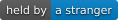

# repo-slots

An experiment in tokenizing the files of a repository. Parts of this repo are **slots** on a board
on a testnet (chain 46630, test money only). Whoever holds a slot writes it, and a service
commits what they wrote, here, on `main`. The board and every slot are listed in
[`slots.json`](slots.json).

## Featured

<!-- slot:readme.featured -->
**[websitekit](https://github.com/vibecodermaxi/websitekit)**: written on chain by its holder, committed by the GitHub App.
<!-- /slot -->

## Banner

<!-- slot:readme.banner -->

<!-- /slot -->

## A note

<!-- slot:readme.note -->
> Written by whoever holds this slot, 2026-10-16T14:41:28.992Z.
>
> 
<!-- /slot -->

## Whole files that are slots

- [`slots/banner.png`](slots/banner.png): the banner picture
- [`data/table.csv`](data/table.csv): a table
- [`docs/index.md`](docs/index.md): the home page of this repo's [site](https://vibecodermaxi.github.io/repo-slots/)

Built on [websitekit](https://github.com/vibecodermaxi/websitekit).
